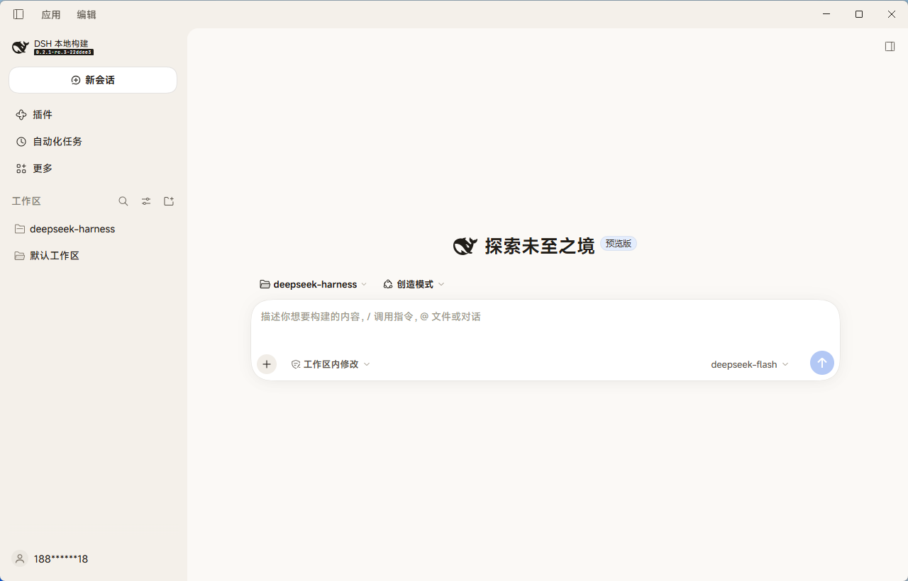
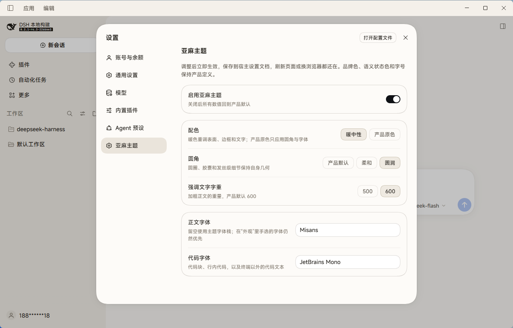

# Linen theme

A warm neutral theme for the DeepSeek Harness Web GUI. It warms the surfaces, rounds the corners one step further, and prefers sharper default fonts — in both light and dark appearance.

中文说明见下方 [中文](#中文).

## Screenshots

Light appearance with the theme applied — the new-session screen, showing the warm surfaces and the softer corner scale:



The theme's settings page, under **Settings → Linen theme**:



## What it changes

| Area | Effect |
|---|---|
| Surfaces | Page, raised layers, overlay, sidebar, code blocks, and scrollbars move to a warm neutral palette |
| Borders and text | Four border steps and seven text steps retuned to the same warm ramp |
| Corner radius | One step softer than the product scale: `4/8/12/16/20/28` → `6/10/14/18/22/32` (a third "round" scale is also selectable) |
| Fonts | Default text and code stacks prefer `system-ui` / `Cascadia Code`; emphasis drops from 600 to 500 |
| Interactive fills | Hover, active, ghost-button, and floating-button fills follow the warm ramp |

## What it deliberately does not change

Each of these is blocked by the Host mechanism, not by taste:

- **Font sizes and line heights** — the theme presenter rewrites them from Settings on every apply, so an override would leave the font-size stepper in Settings doing nothing. Use Appearance → font size instead.
- **Elevation and shadow tokens** — declared on `body, body *`, so a body-level override never reaches the elements that consume them.
- **Menu material** — `--dsw-menu-surface-fill` and `--dsw-menu-backdrop-filter` are theme-owned; overriding them breaks the shared menu blur contract.
- **Product icons** — `ThemeDefinition.icons` exists only on `ctx.theme.register`, which would replace your light/dark preference.
- **Brand, link, and state colors** — a theme that recolors success, warning, error, or link stops communicating state.

Circles, capsules, and hairline details keep their own literal geometry; only the shared `--dsw-radius-*` scale follows the theme.

## Install

The bundle is self-contained: no dependencies are installed at activation time (the schema library is vendored). Install it through the plugin manager with the absolute path to this directory:

```text
plugin_manager { action: "install_bundle", target: "<absolute path to this directory>" }
```

Or from a packed tarball, extract it first and point `install_bundle` at the extracted directory.

Reload the window once after installing. The theme then applies immediately on every later load.

### Update

`install_bundle` refuses an already-installed package. Remove and reinstall:

```text
plugin_manager { action: "remove_bundle", target: "dsh-theme-linen" }
plugin_manager { action: "install_bundle", target: "<absolute path>" }
```

Replacing an installed package requires restarting `dsh` so the browser loads the new module generation.

## Configure

Open **Settings → Linen theme**. Changes apply immediately and are stored in the Host settings document, so they survive a restart and follow you across browsers.

| Setting | Values | Meaning |
|---|---|---|
| Enable the Linen theme | on / off | Off restores every product default |
| Palette | Warm / Product | Product keeps the original colors and applies only corners and fonts |
| Corner radius | Product / Soft / Round | Three radius scales |
| Emphasis weight | 500 / 600 | Weight of emphasized body text; product default is 600 |
| Body font | font list | Empty uses the theme stack; a font chosen in Appearance still wins |
| Code font | font list | Code blocks, inline code, and code text outside the terminal |

Font fields take comma-separated family names and commit on blur or Enter.

## Requirements

- A DeepSeek Harness profile with the Web client (`dsh web` or the desktop app).
- The `theme`, `slots`, `configForms`, and `locale` client services, which the standard Web composition provides.

## Layout

```
index.js              Host half: the Config schema (all fields volatile)
client.js             Browser half: the token layer and the settings page
cordis.patch.yml      Bundle patch that inserts the plugin row
locale/*.json         Plugin manager title and description (8 languages)
icon.svg              Plugin artwork
vendor/               Vendored @deepseek-ai/schemastery and cosmokit builds (MIT)
```

## Notes for theme authors

- Every token value is a `{ light, dark }` pair. The theme service rejects a bare string on purpose: a single value goes illegible when the color scheme flips.
- The layer is applied through `overrideTokens`, so the Appearance preference keeps working and the theme never appears as a fourth choice.
- Settings fields must be `.volatile()`. The settings directory only exposes a namespace when at least one field is live, and a token change must apply without remounting the browser plugin.

## License

MIT for this plugin. The vendored `@deepseek-ai/schemastery` and `@deepseek-ai/cosmokit` builds retain their own MIT licenses, shipped alongside in `vendor/`.

---

<a id="中文"></a>
## 中文

一个暖中性主题。它让界面表面更温暖、圆角再圆一档、默认字体更锐利，亮色和暗色外观同时生效。

### 改了什么

页面与浮层底色、四级边框、七级文字色阶、侧栏、代码块与行内代码、滚动条、插画、悬停与激活填充，统一挪到暖中性色阶；圆角比产品尺度再柔一档；正文字体和代码字体优先使用 `system-ui` 与 `Cascadia Code`；加粗正文从 600 降到 500。

### 刻意不改什么

字号与行高（会被设置里的字号控件覆盖，改了那个控件就成了摆设）、elevation 与阴影（在 `body, body *` 上逐元素声明，body 级覆盖到不了）、菜单材质（主题所有权，覆盖会破坏共享毛玻璃）、产品图标（只在 `register` 上，会顶掉你的亮暗偏好）、品牌色与状态色（改了就不再传达状态）。

圆圈、胶囊和发丝级细节保持自己的字面量几何，只有共享的 `--dsw-radius-*` 尺度跟随主题。

### 安装

这个包是自包含的，激活时不装任何依赖（schema 库已随包携带）。用插件管理器指向本目录的绝对路径安装：

```text
plugin_manager { action: "install_bundle", target: "<本目录绝对路径>" }
```

安装后刷新一次窗口。之后每次加载都会自动生效。

### 更新

`install_bundle` 不允许重复安装同一个包，先移除再装，然后重启 `dsh` 让浏览器加载新的模块。

### 配置

打开 **设置 → 亚麻主题**。改动立即生效，保存在宿主设置文档里，重启后仍在，换浏览器也跟随。可调：启用开关、配色（暖中性 / 产品原色）、圆角（产品默认 / 柔和 / 圆润）、强调字重（500 / 600）、正文字体、代码字体。

字体输入框接受逗号分隔的字体名，失焦或回车提交；留空则使用主题自带的字体栈，而你在「外观」里手选的字体始终优先。
